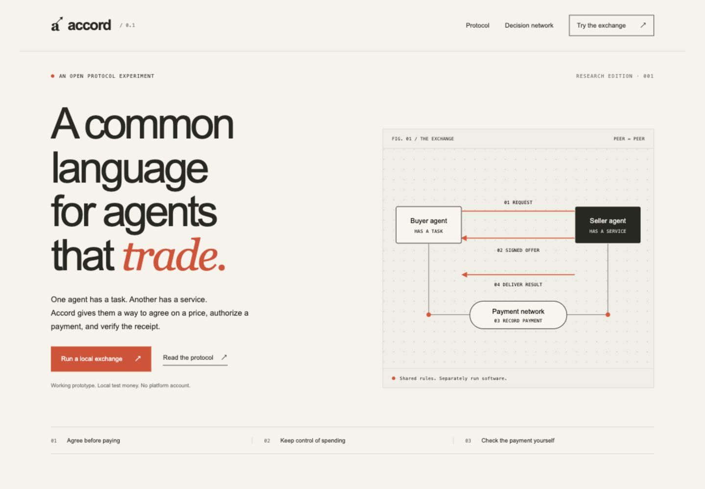

# Accord — payments between AI agents

**Goal: let one AI agent buy a service from another without requiring an account
or payment server operated by Accord.**

For example, a buyer asks a seller to summarize a dataset. The seller signs a
price and description of the work. The buyer checks its spending limit, pays,
and receives a payment receipt and the dataset summary as separate results.

This repository contains **Accord 0.1, a local research prototype**: a payment
contract, separate buyer and seller programs, a website with an interactive demo,
and a linked record of the design decisions. A protocol is the set of shared
message rules those programs follow.

All components currently run on one computer using **valueless Test ETH**.
Independent public operation has not been demonstrated. This is not an audited
payment product or a new currency. Accord is a working name; brand availability
has not been checked.



## Why this repository exists

We are exploring how independently operated agents can agree on work, limit
spending, and recover payment receipts without a mandatory company intermediary.
The local implementation makes these rules executable and testable. The next
step is compatibility with an existing payment protocol and an exchange between
independent operators.

Related work already includes [x402](https://github.com/x402-foundation/x402),
[L402](https://docs.lightning.engineering/the-lightning-network/l402),
[Machine Payments Protocol](https://github.com/tempoxyz/mpp-specs), and
[Agent Payments Protocol](https://ap2-protocol.org/). Accord does not claim to
invent agent payments or to interoperate with these standards yet. See the
[comparison and publication rationale](logs/records/DEC-0015-public-research-release-and-existing-protocol-overlap.md).

## Run locally

Requires Node.js and npm; the recorded development checks used Node.js 26.3.1.
Python 3 is needed only to regenerate or check the decision logs.

```sh
git clone https://github.com/RanjithHiremath/accord-agent-payments.git
cd accord-agent-payments
npm ci --ignore-scripts
npm start
```

Open **http://127.0.0.1:4317** after the launcher reports that it is ready.
No browser wallet or paid AI service is needed. Keep the runtime local; the
[security notes](SECURITY.md) explain its development-only assumptions.

## Try it

1. Open the website and choose **Run a local exchange**.
2. Leave the example numbers or enter 1–100 whole numbers between 0 and 1,000,000.
3. Run **Complete an exchange** to see the payment receipt and dataset summary.
4. Try **Retry the same payment**: it recovers one payment rather than charging
   twice for the same offer.
5. Try **Reject an over-budget offer**: the buyer declines before sending a payment.

The demonstration uses separate buyer and seller programs. They act as the payment
tools an AI agent could call; no paid language-model service or API key is needed.
The dataset service is intentionally simple and reproducible. It is not a claim
that paying another agent to add numbers is itself a useful business.

## Start or restart

The development environment was verified with Node.js 26.3.1 and Python 3.
Dependencies, including the Anvil local blockchain executable, are installed in
this project. Supported native Anvil packages are provided for macOS, Linux, and
Windows; only this machine's installation has been tested.

```sh
cd accord-agent-payments
npm ci --ignore-scripts
npm start
```

Then open http://127.0.0.1:4317. No browser wallet extension is needed.

The launcher starts three local services:

| Address | Role |
| --- | --- |
| `127.0.0.1:4317` | Marketing site, decision network, and demo controls |
| `127.0.0.1:4318` | Seller agent: signed offers and paid delivery |
| `127.0.0.1:8545` | Anvil development blockchain |

All listeners bind to this computer's loopback interface. The local blockchain
accepts development administration commands; do not expose it through a tunnel,
port forward, or public network. See [the security boundaries](SECURITY.md).

Stop the foreground launcher with **Ctrl+C**. A normal stop closes its child
services and releases the runtime lock. Each full restart creates a fresh chain,
new test wallets, and a new payment contract. Old demonstration receipts refer to
the previous, discarded chain. Restarting only the seller while the chain remains
running preserves access to paid results.

If a forced termination leaves `.local/runtime.lock`, verify that the previous
launcher and its services have stopped before removing that stale lock. Do not
start a second launcher against another active development chain. The chain helper
refuses to use an occupied port.

The launcher stores disposable keys in `.local/wallets.json` with owner-only file
permissions. This directory is ignored by Git and is never served by the website.
Do not use those keys on another network or put valuable funds in them.

## Run without the website

While the launcher is running, in another terminal:

```sh
npm run demo
npm run demo -- replay
npm run demo -- budget
```

Each command returns named public fields, including the buyer and seller,
transaction identifier, payment and transaction fee in wei, and the delivered
dataset summary. A wei is the smallest unit of ETH: 1 ETH equals 10^18 wei.

An application can also import `runDemo` from `runtime/buyer.mjs`, or integrate the
lower-level `validateOffer` and `payOffer` functions from `lib/protocol.mjs`.
Read [PROTOCOL.md](PROTOCOL.md) before integrating: the example is deliberately
limited to chain 31337, the local development chain.

## What works and what is still open

| Demonstrated locally | Not established by this prototype |
| --- | --- |
| Seller-signed offers naming buyer, price, work, expiry, and payment contract | Compatibility with x402, L402, AP2, or independent implementations |
| Actual contract execution and transfer of development balances | Public-network settlement or economic value |
| Per-purchase payment and transaction-fee caps | Durable budgets across multiple processes or machines |
| One payment per signed offer and recovery of paid receipts | Seller availability or automatic refunds |
| Repeatable delivery after seller restart and after a paid quote expires | Trustless delivery of arbitrary work or physical goods |
| An ownerless payment contract with no project fee | Decentralized discovery, independent operators, or independent security audit |

The buyer pays before delivery. A signed fingerprint lets it check that the
response matches the promised content, but it does not force a seller to remain
available. Possession of a paid offer allows delivery in this version; the delivery
endpoint does not separately authenticate the requesting buyer. Use no private
datasets in this demonstration.

## Verify the work

```sh
npm test
python3 scripts/decision_log.py --check
npm audit
```

Tests start isolated, temporary Anvil processes on available loopback ports. They
exercise actual contract and HTTP behavior, not a simulated balance table. They
do not alter the main demonstration chain. The dependency audit is a time-specific
check against known package advisories, not a security audit of this protocol.

## Find the reasoning

- [Decision network](logs/INDEX.md): every research topic and choice, with
  definitions, alternatives, reasons, references, and links to related records.
- [Logging convention](logs/README.md): stable IDs and append-only history.
- [Protocol specification](PROTOCOL.md): exact messages and verification behavior.
- [Security boundaries](SECURITY.md): trust assumptions and unsupported guarantees.
- [Validation evidence](VALIDATION.md): test results, browser checks, and remaining gaps.
- [Project goal](GOAL.md): scope and progress.

To regenerate the readable records after appending new entries:

```sh
python3 scripts/decision_log.py
python3 scripts/decision_log.py --check
```

The website's **Decision network** reads the same ledger. Earlier proposals remain
visible as history; links marked `supersedes` show which newer decision replaces
them.

## Next step toward independent operation

Choose a real service and its delivery requirements, implement a tested adapter to
an existing payment standard, and run a public test-network trial between two
independent operators. That trial should work without this project's website,
directory, or hosted gateway. Only then assess discovery, sustainable spending
controls, privacy, and a separately reviewed real-money deployment.

## Repository map

| Location | Purpose |
| --- | --- |
| `contracts/AccordPayments.sol` | Checks signed terms and transfers development funds once per offer |
| `lib/protocol.mjs` | Validates offers, enforces per-purchase limits, and recovers receipts |
| `runtime/` | Runs the local blockchain, seller, buyer, and website |
| `test/` | Exercises contract behavior and complete local exchanges |
| `web/` | Marketing website, demo controls, and decision explorer |
| `logs/` | Connected research and decision records with definitions and sources |

## Contributing and license

See [CONTRIBUTING.md](CONTRIBUTING.md) for naming conventions and verification.
Original code and documentation are available under the [MIT license](LICENSE).
Dependencies retain their own licenses. Historical log references to local tools
and conversation evidence describe the development process; those external tools
and conversations are not included in this repository.
