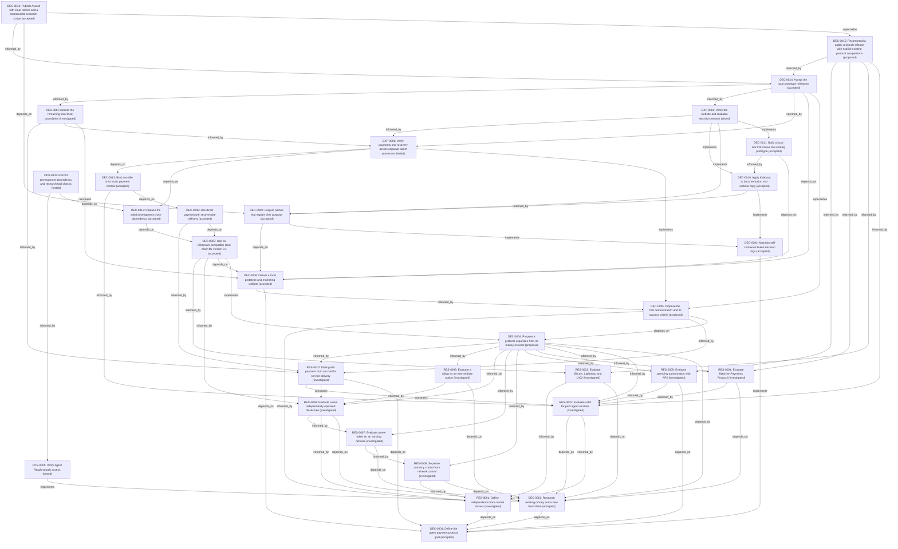

# Decision network

Generated from the append-only ledger. Proposals are not accepted architecture.

[Project goal](../GOAL.md) · [How to use the logs](README.md) · [Source catalog](SOURCES.md)

| Record | Status | Purpose |
| --- | --- | --- |
| [DEC-0001 — Define the agent payment protocol goal](records/DEC-0001-agent-payment-protocol-goal.md) | accepted | I am writing this log to establish the objective that later design decisions must serve. |
| [DEC-0002 — Maintain self-contained linked decision logs](records/DEC-0002-self-contained-linked-decision-logs.md) | accepted | I am writing this log to choose a durable format for the user-required decision network. |
| [DEC-0003 — Research existing money and a new blockchain](records/DEC-0003-research-both-settlement-paths.md) | accepted | I am writing this log to preserve the instruction to compare both directions before selecting the architecture. |
| [RES-0001 — Define independence from central servers](records/RES-0001-independence-from-central-servers.md) | investigated | I am writing this log to turn “nobody’s server” into a testable requirement. |
| [RES-0002 — Evaluate x402 for paid agent services](records/RES-0002-x402-internet-payments.md) | investigated | I am writing this log to determine how much of the payment exchange already exists. |
| [RES-0003 — Evaluate Bitcoin, Lightning, and L402](records/RES-0003-bitcoin-lightning-and-l402.md) | investigated | I am writing this log to assess whether Bitcoin payments fit the project’s independence requirement and to explain their operational burden. |
| [RES-0004 — Evaluate Machine Payments Protocol](records/RES-0004-machine-payments-protocol.md) | investigated | I am writing this log to avoid comparing only one existing machine-payment standard. |
| [RES-0005 — Evaluate spending authorization with AP2](records/RES-0005-agent-payment-authorization.md) | investigated | I am writing this log to separate permission to spend from the mechanism that transfers funds. |
| [RES-0006 — Separate currency control from network control](records/RES-0006-currency-control-and-value.md) | investigated | I am writing this log to make asset-level dependencies visible before choosing a currency. |
| [RES-0007 — Evaluate a new token on an existing network](records/RES-0007-new-token-existing-network.md) | investigated | I am writing this log to distinguish creating a currency from operating a new blockchain. |
| [RES-0008 — Evaluate a new independently operated blockchain](records/RES-0008-new-blockchain-security-and-operations.md) | investigated | I am writing this log to assess the benefits and responsibilities of building the money network itself. |
| [RES-0009 — Evaluate a rollup as an intermediate option](records/RES-0009-rollup-middle-path.md) | investigated | I am writing this log to examine an option between full reuse and a fully separate chain. |
| [RES-0010 — Distinguish payment from successful service delivery](records/RES-0010-payment-versus-service-delivery.md) | investigated | I am writing this log to prevent a payment guarantee from being mistaken for a guarantee about arbitrary goods or work. |
| [DEC-0004 — Propose a protocol separable from its money network](records/DEC-0004-proposed-settlement-independent-design.md) | proposed | I am writing this log to turn the comparison into a provisional engineering recommendation. |
| [DEC-0005 — Propose the first demonstration and its success criteria](records/DEC-0005-first-demonstration-success-criteria.md) | proposed | I am writing this log to define what the first implementation should prove and what it cannot prove. |
| [OPS-0001 — Verify Agent Reach search access](records/OPS-0001-agent-reach-search-validation.md) | tested | I am writing this log to distinguish installed capability from observed working access. |
| [DEC-0006 — Deliver a local prototype and marketing website](records/DEC-0006-autonomous-local-prototype-and-website.md) | accepted | I am writing this log to make the delivery scope and delegated decision authority explicit. |
| [DEC-0007 — Use an Ethereum-compatible local chain for version 0.1](records/DEC-0007-existing-network-first-implementation.md) | accepted | I am writing this log to choose the first implementation after researching both existing and new money networks. |
| [DEC-0008 — Use direct payment with recoverable delivery](records/DEC-0008-direct-payment-and-recoverable-delivery.md) | accepted | I am writing this log to choose the version 0.1 payment and delivery guarantees. |
| [DEC-0009 — Require names that explain their purpose](records/DEC-0009-clear-domain-names-and-output-labels.md) | accepted | I am writing this log to turn the user’s naming requirement into a reviewable project convention. |
| [DEC-0010 — Apply Kalidasa to documentation and website copy](records/DEC-0010-kalidasa-reader-first-writing.md) | accepted | I am writing this log to explain how the requested writing skill will affect the project records. |
| [DEC-0011 — Build a local site that shows the working prototype](records/DEC-0011-local-marketing-site-and-working-demo.md) | accepted | I am writing this log to select the website’s purpose and implementation approach. |
| [DEC-0012 — Replace the initial development-chain dependency](records/DEC-0012-anvil-and-patched-development-dependencies.md) | accepted | I am writing this log to explain the change in development tooling and preserve the reason for the added version override. |
| [DEC-0013 — Bind the offer to its exact payment context](records/DEC-0013-structured-offers-and-single-payment-record.md) | accepted | I am writing this log to explain why the signed message and one-payment state are separate mechanisms. |
| [EXP-0001 — Verify payments and recovery across separate agent processes](records/EXP-0001-local-payment-and-agent-integration-tests.md) | tested | I am writing this log to record the observed behavior and defects corrected before the local handoff. |
| [RES-0011 — Record the remaining local trust boundaries](records/RES-0011-remaining-trust-and-local-rpc-boundaries.md) | investigated | I am writing this log to preserve unresolved boundaries instead of describing a passing test suite as complete security. |
| [EXP-0002 — Verify the website and readable decision network](records/EXP-0002-website-and-decision-network-browser-checks.md) | tested | I am writing this log to record user-facing verification separately from backend tests. |
| [OPS-0002 — Record development dependency and research-tool checks](records/OPS-0002-dependency-and-research-tool-verification.md) | tested | I am writing this log to preserve the final package-check result and Agent Reach version observation. |
| [DEC-0014 — Accept the local prototype milestone](records/DEC-0014-local-milestone-handoff.md) | accepted | I am writing this log to distinguish the completed local deliverable from the broader public-network ambition. |
| [DEC-0015 — Recommend a public research release with explicit existing-protocol comparisons](records/DEC-0015-public-research-release-and-existing-protocol-overlap.md) | proposed | I am writing this log to decide how to describe and potentially publish Accord honestly in light of existing work. |
| [DEC-0016 — Publish Accord with clear names and a reproducible research scope](records/DEC-0016-publish-accord-agent-payments-research-repository.md) | accepted | I am writing this log to record the public release authorization, repository naming, readable code conventions, and packaging boundary. |

## Relationship map

Arrows read “source depends on / is informed by / implements target”. Each record page also lists incoming links.

